# QuickCards

QuickCards is a local-first, offline Android vault for credit and debit cards. It is built
for the shortest path from opening the app to copying the value you need: the card
number, expiry and CVV copy straight from the card list, while every sensitive value stays
encrypted at rest with an Android Keystore key and gated behind your fingerprint or device
PIN. The app has no internet or camera permission; data leaves the phone only as an
encrypted backup that you export yourself and open with its backup password.

<p align="center">
  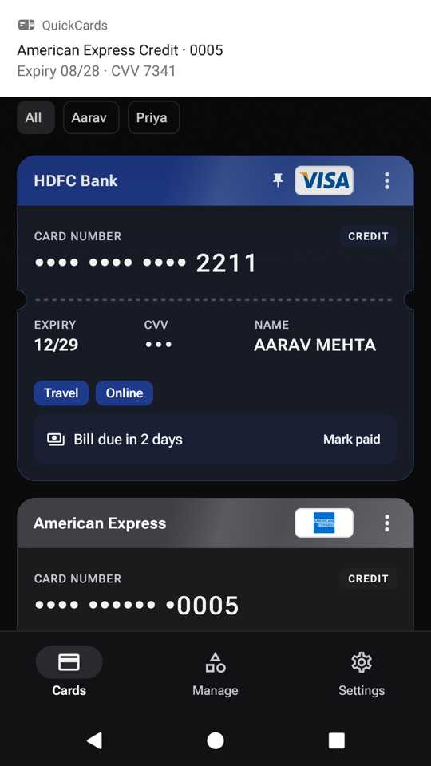
  &nbsp;
  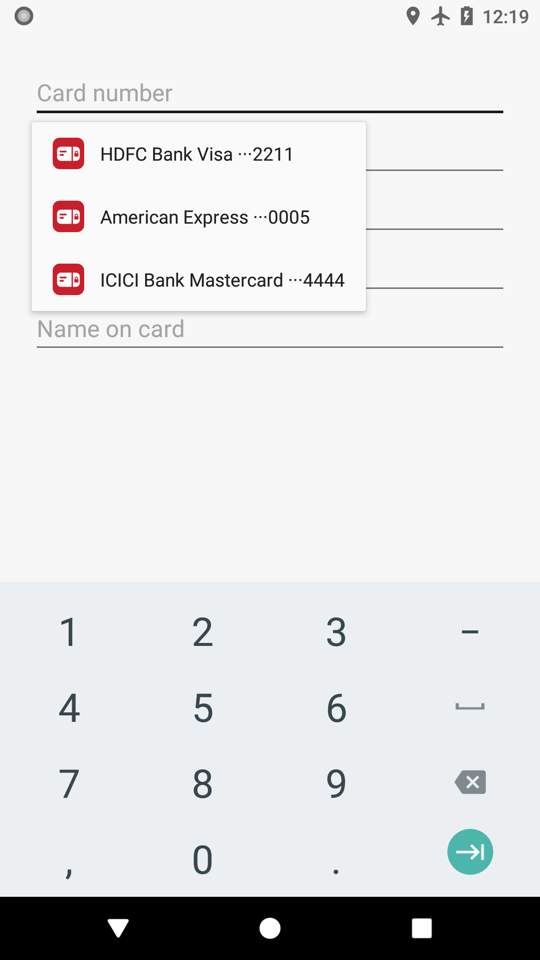
  &nbsp;
  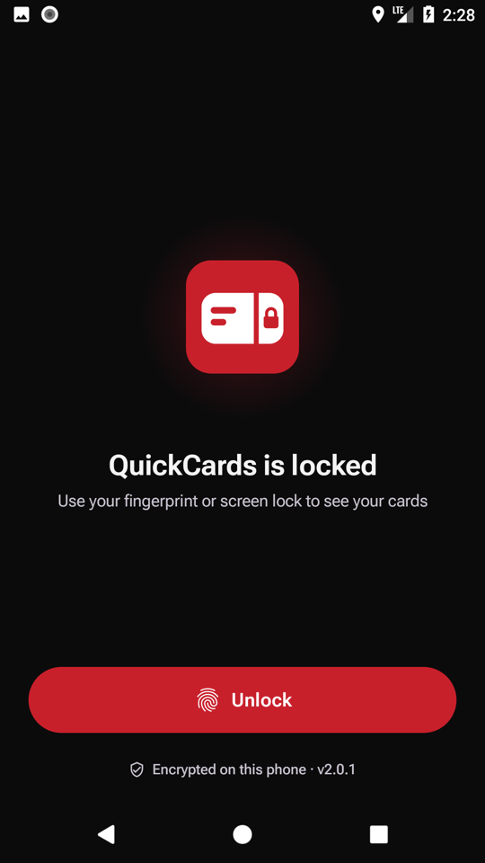
</p>

<p align="center"><sub>Demo data with public test card numbers. Release builds block screenshots.</sub></p>

## Screenshots

<table>
  <tr>
    <td align="center">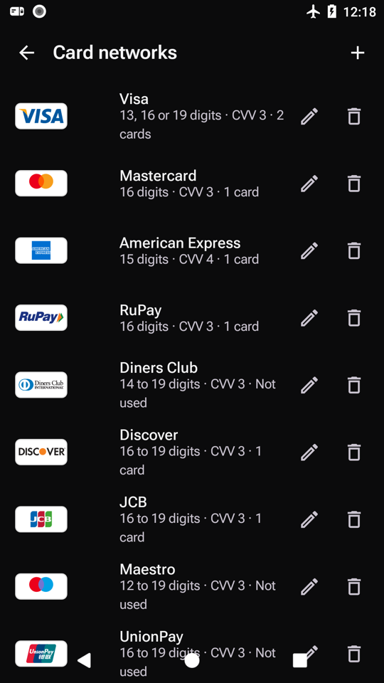<br><sub>Official network marks</sub></td>
    <td align="center">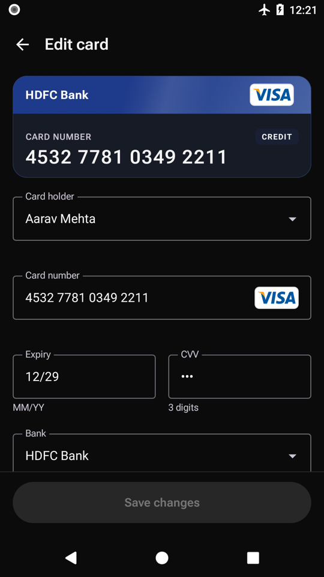<br><sub>Edit with a live preview</sub></td>
    <td align="center">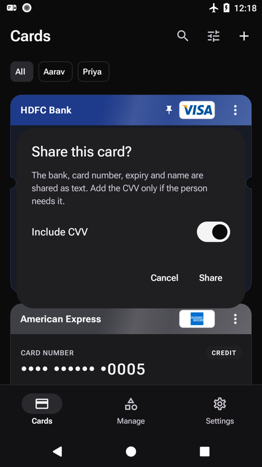<br><sub>Share, CVV only if you choose</sub></td>
  </tr>
  <tr>
    <td align="center">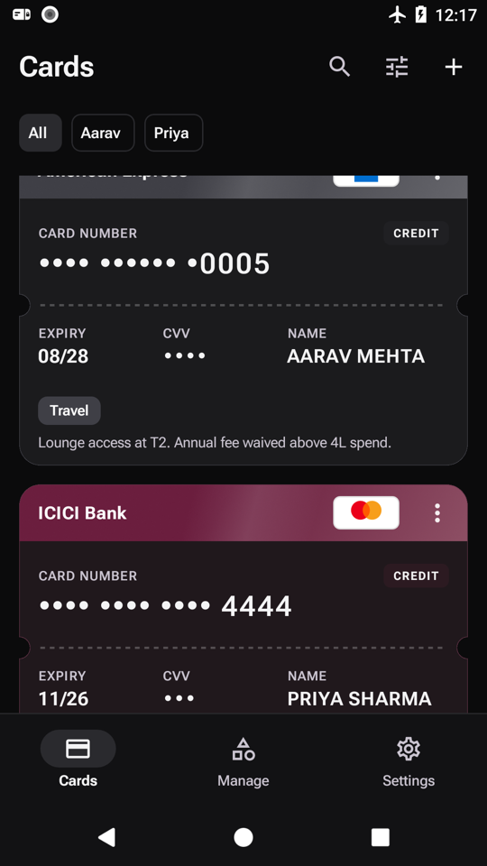<br><sub>Tags and notes on the card</sub></td>
    <td align="center">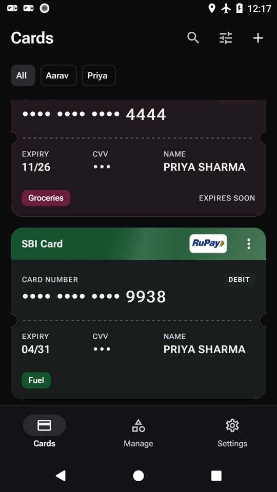<br><sub>Expires soon</sub></td>
    <td align="center">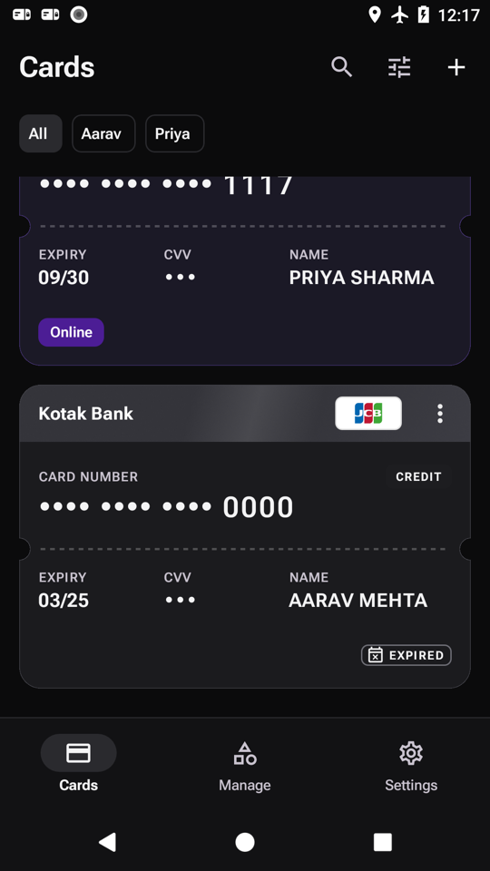<br><sub>Expired cards turn graphite</sub></td>
  </tr>
  <tr>
    <td align="center">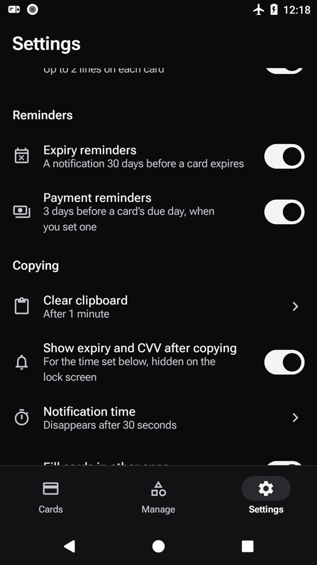<br><sub>Expiry and payment reminders</sub></td>
    <td align="center">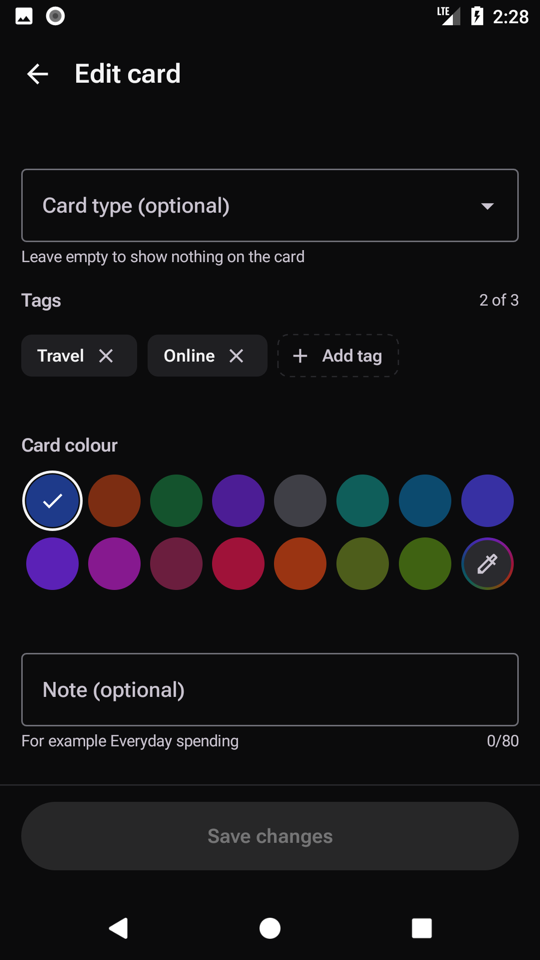<br><sub>15 colours plus a custom picker</sub></td>
    <td align="center">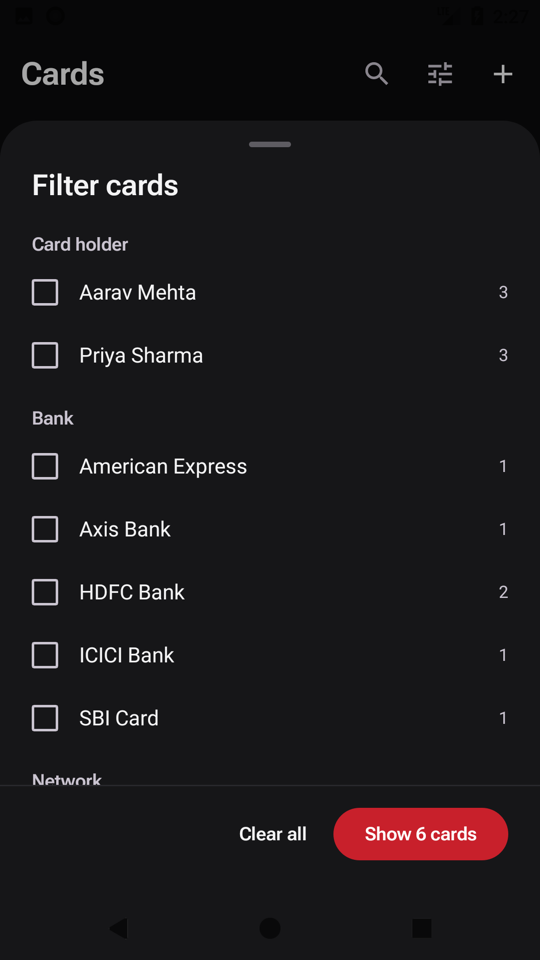<br><sub>Filter by holder, bank, network, tag</sub></td>
  </tr>
  <tr>
    <td align="center">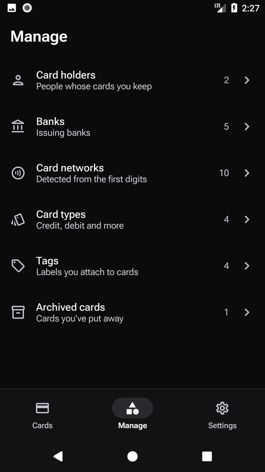<br><sub>Manage everything in one place</sub></td>
    <td align="center">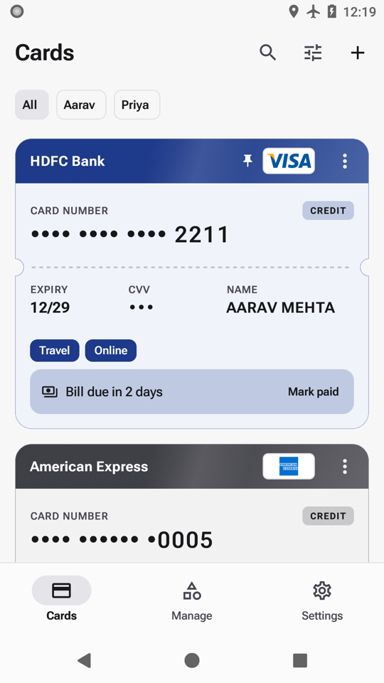<br><sub>Light theme</sub></td>
    <td align="center">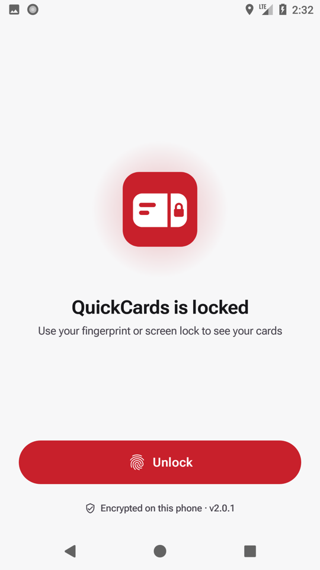<br><sub>Lock screen, light</sub></td>
  </tr>
</table>

## Features

- **Copy from the list.** Each card is a "Pass Stub": tap the number, expiry, CVV or name
  to copy it. Numbers are masked to the last four digits; hold to reveal for five seconds.
- **Instant-copy window.** One fingerprint or device-PIN prompt opens a short window
  (30 s – 2 min, default 1 min, counted as idle time) in which copies and reveals need no
  further prompt.
- **App lock.** Locks on launch and asks for your fingerprint straight away. Also locks
  after inactivity (10 s – 30 min or never), when you leave the app, or with Lock now. Locking closes every dialog and clears revealed values. The
  clipboard and the notification keep their own timers, so you can switch to the app you
  are pasting into.
- **Expiry and CVV notification.** After copying a number, an optional heads-up
  notification shows that card's expiry and CVV for a configurable time; it stays in the
  shade while you switch apps and is hidden on the lock screen.
- **Several card holders.** Manage holders, banks, card networks (with editable rules),
  card types and tags. Renames that affect cards ask first; items in use cannot be
  deleted.
- **Card formats.** 12–19 digit numbers, automatic network detection by prefix, per-network
  grouping, CVV length and Luhn check; 10 built-in networks plus custom ones. Built-in networks show their official mark on the card. Duplicate
  numbers are rejected across all holders.
- **Reminders.** A notification 30 days before a card expires and, if you set a payment due day on a card, 3 days before it, with a "Bill due" strip on the card and a Paid button on both; both can be switched off.
- **Autofill in other apps.** Set QuickCards as Android's autofill service and checkout forms offer your cards; one fingerprint fills number, expiry, CVV and name straight into the form, with no clipboard. It can be switched off in Settings.
- **Share a card.** From a card's menu, after the unlock prompt; you choose whether the CVV goes along (off by default) before the system share sheet opens.
- **Pinning, notes, archive.** Pin up to 10 cards to the top, show notes on
  cards, archive cards with an optional reason and restore them later.
- **Expired / expires soon.** Expired cards turn graphite and can stay in place, move to
  the end or be hidden; cards expiring within 1–3 months get a label.
- **Keyboard scan and smart paste.** Pasting (or using your keyboard's scan-text tool)
  fills the number and expiry. The CVV is never filled from pasted text, and the app
  requests no camera permission.
- **Encrypted backup.** Export to a file protected by a backup password and import it on another
  phone, with a review of new, changed and unchanged cards. Older backup formats still
  import, and legacy values are repaired (with a 30-day undo) on upgrade and on import.
- **Look and feel.** Material 3, pitch-black dark and light themes, optional Material You
  colours, 15 card colours plus a custom colour picker, adaptive layouts for tablets and
  foldables.

## Privacy and security model

| Area | What QuickCards does |
|---|---|
| Card number, expiry, CVV | Envelope encryption: a non-exportable Android Keystore key wraps a random AES-256 data key, which encrypts each field with AES-256-GCM (random 12-byte IV, 128-bit tag). The data key is unwrapped once per session and never stored in the clear |
| Holder, bank, note, archive reason | Encrypted with the same Keystore key in a metadata envelope |
| Duplicate detection | A separate Keystore HMAC-SHA256 key over the digits; only the hash is indexed |
| App lock | `BiometricPrompt` with device-credential (PIN/pattern/password) fallback; fail-closed — a cancelled or failed prompt never lets a copy, reveal, edit, delete, export, import or erase proceed |
| Instant-copy window | One successful prompt unlocks sensitive actions for a short, configurable idle window; locking ends it |
| Screen capture | `FLAG_SECURE` on every activity in release builds: no screenshots, screen recording or recents preview |
| Clipboard | Copied values are cleared after the chosen time (never / 30 s / 1 min / 2 min), when you tap Clear, or when you copy something else. They stay while you switch to the app you are pasting into, and the keyboard's clipboard preview shows them |
| Network and camera | No `INTERNET`, `ACCESS_NETWORK_STATE` or `CAMERA` permission. Unit tests and a Gradle task check the merged manifests, and CI checks the release APK's permissions before publishing |
| Android backup | `allowBackup=false`; app data is not copied to cloud backups |
| Export / import | PBKDF2-HMAC-SHA256 (600,000 iterations, 16-byte salt) + AES-256-GCM with an authenticated header. The backup password is never stored |
| Keystore key lost | If the key disappears (uninstall, clearing app data, some lock-screen resets), encrypted cards cannot be decrypted. QuickCards detects this with an encrypted sentinel, hides the unreadable cards instead of showing ciphertext and does not offer to delete them. Recovery is only possible from an exported backup, so export regularly |

Debug builds deliberately allow screenshots for visual QA. Only install release builds
with real card data.

## Install

1. Download `QuickCards-<version>.apk` and `QuickCards-<version>.apk.sha256` from
   [GitHub Releases](https://github.com/allenhack638/QuickCards/releases).
2. Verify the checksum before installing:

   ```bash
   shasum -a 256 QuickCards-<version>.apk
   cat QuickCards-<version>.apk.sha256
   ```

   The two hashes must match.
3. Install the APK on your phone (allow installs from your browser or file manager when
   asked). Android 8.0 (API 26) or later is required.

Builds signed with a different key cannot install over each other. To move between them,
export a backup, uninstall, install the new APK and import the backup.

## Build and test

Requirements: JDK 17 (the version CI uses; AGP 8.7, Gradle 8.11) and Android SDK 34.
Run from the repository root:

```bash
./gradlew :domain:test              # pure Kotlin rules
./gradlew :app:assembleDebug        # debug APK
./gradlew :app:testDebugUnitTest    # JVM tests, including the guard tests
./gradlew :app:lintDebug            # lint
./gradlew :app:assembleRelease      # needs a git-ignored keystore.properties
```

Instrumented tests must target one chosen device or emulator; see
[`AGENTS.md`](AGENTS.md#instrumented-tests). Never run them on a phone that holds real
cards.

Contributor rules (offline only, mandatory encryption, non-destructive migrations,
strings and tokens via resources/theme) are in [`AGENTS.md`](AGENTS.md); architecture,
the security model and change recipes are in [`docs/MAINTAINING.md`](docs/MAINTAINING.md).

## Releasing

1. Bump `versionCode` (+1) and `versionName` in `app/build.gradle`.
2. Merge to `main`. CI (`.github/workflows/release.yml`) runs the tests, lint and offline
   check, builds and signs the release APK, verifies its signature and permissions, tags
   `v<versionName>` and publishes the APK with its SHA-256 file on GitHub Releases. A
   merge without a version bump publishes nothing.

Signing secrets and key custody are documented in [`keystore/README.md`](keystore/README.md).
Never commit a keystore, `keystore.properties` or a password.

## Project layout

```
app/src/main/java/com/quickcards/app/
├── core/          # data (Room, repository, settings, backup), security, notifications, ui (theme, Qc overlays)
├── feature/       # cards, cardform, manage, archive, settings, lock, backup
├── navigation/    # QcApp: NavHost, bottom bar / rail
└── MainActivity.kt
app/schemas/       # committed Room schema JSON per database version
domain/            # pure Kotlin rules: card numbers, validation, search, backup planning
prototype/         # HTML behaviour spec (v2.html), design timeline, reference screenshots
docs/              # MAINTAINING.md and the Stub Lock brand masters (docs/brand/stub-lock)
```

## Licence

QuickCards is released under the [MIT licence](LICENSE), © 2025-2026 allenhack638.

The Stub Lock logo and QuickCards brand assets are © allenhack638 and are **not** covered
by the MIT licence unless stated otherwise. Visa, Mastercard, American Express, RuPay, Diners Club, Discover, JCB, Maestro, UnionPay and Mir, and their marks, are trademarks of their respective owners; QuickCards shows them only to identify a card's network and is not affiliated with or endorsed by them. The bundled Roboto Flex font is licensed under
the SIL Open Font License 1.1. Other third-party components are listed in
[`THIRD_PARTY_NOTICES.md`](THIRD_PARTY_NOTICES.md).

QuickCards is provided as is. You are responsible for securing your device with a strong
screen lock and for keeping encrypted backups.
